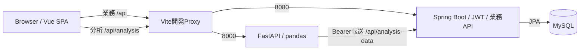

# ShuttleUp アーキテクチャ

更新日：2026-10-14。現在のリポジトリと設定を基準とする。「現行仕様」「改善案」「決定待ち」を区別し、未実行の検証は成功として記載しない。

## 全体構成

Vite Proxyは開発用。本番は静的配信＋同じAPI分岐のリバースプロキシを用意する。FastAPIはMySQLへ直接接続せず、Spring Bootに認証・所有者検査・データ取得を委ねる。

## コンポーネントの責務

| ID | 要素 | 責務 | 呼出関係 | 境界 |
|---|---|---|---|---|
| SYS-001 | Vue SPA | 9ルート・13設計画面、フォーム、グラフ、森。表示状態はVue／Pinia。 | HTTP → Spring／FastAPI | JWTはsessionStorage、テーマ・言語はlocalStorage。 |
| SYS-002 | Vite開発Proxy | /api/analysisを8000、それ以外/apiを8080へ。開発専用。 | Browser → Proxy → 各API | 本番は同等の分岐とSPA fallbackを配信側で用意。 |
| SYS-003 | Spring Controller | DTO受入、@Valid、HTTPステータス・応答。 | Controller → Service | Entityを直接応答しない。秘密値を返さない。 |
| SYS-004 | Spring Service | 所有者・業務条件、トランザクション、応答マッピング。 | Service → Repository | @Transactional。基本情報・明細・試合の保存は別処理。 |
| SYS-005 | JPA／MySQL | 8テーブル66列9関連。IDENTITY id、email UK。 | Repository → MySQL | 物理DDLは実DB依存。ER／テーブル定義書で照合。 |
| SYS-006 | FastAPI | JWTを要求しSpringへ転送。pandasで分析。業務DBへ直接接続しない。 | FastAPI → Spring AD-001 → 計算 | userId所有者確認はSpringが担当。HTTPクライアントはアプリ単位。 |
| SYS-007 | 分析計算 | 頻度・重量・勝敗・カテゴリ件数／時間比率。 | 取得データ → TrainingReport | 同日重複・NULL・欠損・丸め・分類警告を定義。 |
| SYS-008 | 開発起動 | dev.mjsが3プロセス、依存・ポートチェック、子プロセス停止。 | MySQL準備 → 3サービス起動 | ポート起動確認は業務正常性を保証しない。手動smokeを追加。 |

## 主要データフロー

1. 登録：Vue→AuthController→AuthService→BCrypt→UserRepository。登録後はログインへ。
2. ログイン：BCrypt照合→JWT発行→sessionStorage→各APIへBearer。署名・状態・versionはSpringで確認。
3. 記録：Controller DTO検証→Service所有者確認→トランザクション保存→Response DTO。新規は採番IDの詳細URLへ。
4. 分析：Vue→FastAPI→JWTを要求単位でSpring AD-001へ転送→期間データ取得→pandas→TrainingReport。
5. 森林：TS-001の本人セッション→端末当日までを1株ずつ→植物の思い出→詳細URL。

## データと保存単位

8テーブルのERは[編集可能なER図](仕様書/ID書/ER図.xlsx)。基本情報・明細・試合は別APIで保存し、基本情報の未保存破棄では他の保存を取り消さない。削除は物理削除で、JPAの自動カスケードを指定していない。

## 設定と設計境界

| 項目 | 現行／条件 | 状態 |
|---|---|---|
| java.version | 21。ビルド／実行にJDK21。 | 確定 |
| Spring Boot | 4.1.0（pom）。依存の指定値。最新バージョンという意味ではない。 | 確定 |
| Node／npm | NodeはVite8依存と互換な版。固定版は未設定。。node --version、npm --versionを実行記録へ。 | 固定版決定待ち |
| requires-python | >=3.12。仮想環境を作成しpip install -e ".[test]"。 | 確定 |
| サービスPort | Vue5173／Spring8080／FastAPI8000／MySQL3306。起動スクリプトはポート競合時に中断。 | 確定 |
| SPRING_PROFILES_ACTIVE | 既定dev。本番はprodを外部指定。。devのみ初期マスター補完。prodは自動補完しない。 | 本番指定必須 |
| SPRING_DATASOURCE_URL／USERNAME／PASSWORD | 本番は外部提供。秘密値は記載しない。。prodファイルの接続値は空欄。実DBの文字セット／権限を確認。 | 本番決定待ち |
| SHUTTLEUP_JWT_SECRET | Base64、復号後32byte以上。未設定時は起動ごとにランダム鍵。多インスタンス／再起動を考慮し固定鍵を外部管理。 | 本番設定必須 |
| SPRING_JPA_HIBERNATE_DDL_AUTO | 現行dev／prod=update。本番は承認DDL反映後にvalidate等の運用へ外部上書きする案。自動移行ツールなし。 | 本番方針決定待ち |
| SPRING_JPA_SHOW_SQL | 現行true。本番はfalseを外部指定する案。ログ内容・保持方針を決定。 | 本番方針決定待ち |
| SPRING_API_BASE_URL | http://localhost:8080（開発例）。必須。/apiではなくSpringの基底URL。 | 確定 |
| SPRING_API_TIMEOUT_SECONDS | 10。HTTPクライアントの既定秒。負荷SLOではない。 | 確定 |
| CORS_ALLOWED_ORIGINS | ["http://localhost:5173"]（開発）。本番OriginとSpring側Originも合わせて決定。 | 本番決定待ち |
| VITE_ANALYSIS_API_BASE_URL | 未指定なら相対URL経由。分析APIのbaseURL。設定時は/api/analysisとの二重付加を避ける。ビルド時に反映。 | 構成に合わせ設定 |
| SPA配信とProxy | 配信先／URLは未決定。/api/analysis優先、/api→Spring。ページURL再読込はindex.htmlへ。 | 本番決定待ち |
| 監視・バックアップ・保持 | 未構築／未承認。担当者、通知先、RTO/RPO、保管先、保留期間を決める。 | 本番決定待ち |

本番ホスト・サービス管理・SLO・監視は決定待ち。Docker、CI/CD、refresh token、サーバーlogoutは現行に存在しない。

参照：[基本設計書](仕様書/ED書/システム構成・基本設計書.xlsx)、[API](api-design.md)、[DB](database-design.md)、[運用](deployment.md)。根拠：frontend/src、backend/src/main、python-analysis/app、scripts/dev.mjs。
